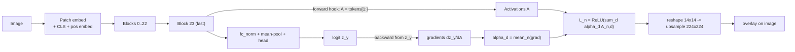

# Grad-CAM for the Fine-Tuned RETFound ViT

Method notes for `grad_cam_retfound.py`. Explains how Grad-CAM is adapted from
convolutional feature maps to a Vision Transformer's token sequence, and why
the last transformer block is the correct attribution target for this
specific model (`models_vit.py`).

## 1. Forward pass recap

Given an image $x$, `RETFound_mae` (`models_vit.py`) computes:

1. Patch embedding + CLS token prepend + positional embedding → token sequence
   $T^{(0)} \in \mathbb{R}^{(N+1)\times D}$, with $N=196$ patches (14×14 grid,
   patch size 16, input size 224) and $D=1024$.
2. $L = 24$ transformer blocks: $T^{(l)} = \text{Block}_l(T^{(l-1)})$.
3. Since this checkpoint was trained with `global_pool=True`, the patch tokens
   of the **last block's output** $A = T^{(L)}_{1:N}$ (CLS token dropped) are
   mean-pooled and normalized, then passed through the linear head. `LN` is
   applied **twice** here — once inside `forward_features` on the pooled
   tensor, once more in timm's inherited `forward_head` (see §3) — not a typo:

$$
z = W_{\text{head}} \cdot \text{LN}\!\left(\text{LN}\!\left(\frac{1}{N}\sum_{n=1}^{N} A_n\right)\right) + b_{\text{head}} \in \mathbb{R}^{K}
$$

$z_y$ is the logit for class $y$ (here $K=2$: `DME`, `DR`).

## 2. Grad-CAM, adapted to tokens

Classic Grad-CAM (Selvaraju et al., 2017) weights a convolutional feature map
$A \in \mathbb{R}^{H\times W \times D}$ by how much each channel's *average
spatial activation* affects the target logit, then collapses channels:

$$
\alpha_d = \frac{1}{HW}\sum_{i,j} \frac{\partial z_y}{\partial A_{ij,d}}
\qquad
L_{ij} = \text{ReLU}\!\left(\sum_d \alpha_d A_{ij,d}\right)
$$

A ViT has no spatial feature map, but its last-block patch tokens
$A \in \mathbb{R}^{N \times D}$ play the same structural role that the last
conv layer plays in a CNN — the mean-pool over $N$ tokens here is the exact
counterpart of the spatial global-average-pool there. So the token index $n$
replaces the pixel index $(i,j)$:

$$
\alpha_d = \frac{1}{N}\sum_{n=1}^{N} \frac{\partial z_y}{\partial A_{n,d}}
\qquad
L_n = \text{ReLU}\!\left(\sum_{d=1}^{D} \alpha_d\, A_{n,d}\right)
$$

$L \in \mathbb{R}^{N}$ is then min-max normalized, reshaped $196 \to 14\times14$,
and bicubic-upsampled to $224\times224$ for the overlay.

## 3. Why the last block, specifically

`forward_head` (inherited from timm, unmodified) runs after `forward_features`
and — because `models_vit.py` keeps a separate `fc_norm` while also setting
`self.global_pool` as a bool — applies the LayerNorm a second time before the
head. This is a quirk of how the checkpoint was actually trained, not a bug
to route around, so `compute_gradcam` calls the model normally
(`logits = model(img_tensor)`) rather than reimplementing the head, ensuring
the gradient path matches the real trained computation exactly.

## 4. Pipeline

## 5. Code ↔ math

| Symbol | `grad_cam_retfound.py` |
|---|---|
| $A$ (activations) | `activation["value"]` via forward hook on `model.blocks[-1]` |
| $\partial z_y/\partial A$ | `act.grad`, populated by `output.retain_grad()` + `logits[0, target_class].backward()` |
| $\alpha_d$ | `weights = grad.mean(dim=0)` |
| $L_n$ | `cam = relu((weights * acts).sum(-1))` |
| normalize + reshape + upsample | `render_gradcam` |

## 6. Caveats

- **ReLU clips negative attribution** — a low/blue score means "not positive
  evidence for this class," not "evidence against it." Grad-CAM here can't
  show what pushed the prediction *away* from a class.
- **Normalization is per-image** (`cam / cam.max()`), so intensity is only
  comparable within a single heatmap, not across different images or runs.
- Gradients must actually flow to `blocks[-1]` — a freshly constructed model
  has `requires_grad=True` on all parameters by default (this flag isn't
  saved in the checkpoint's state dict), so no special handling is needed
  even though the source run froze the backbone for linear probing.
